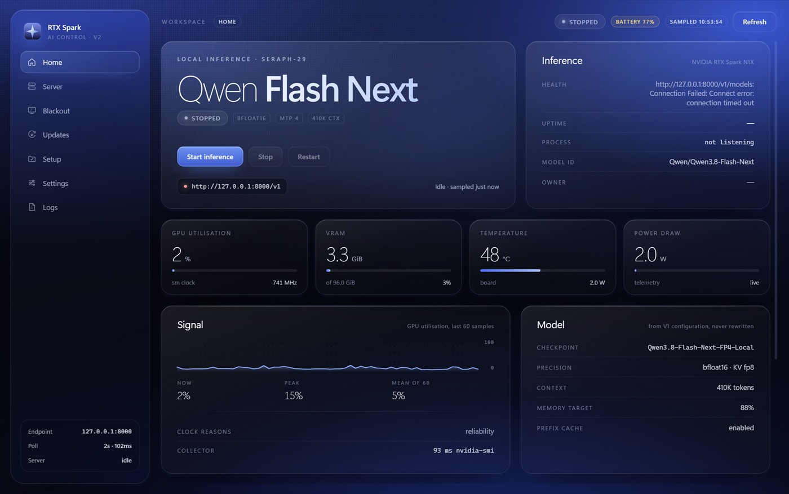
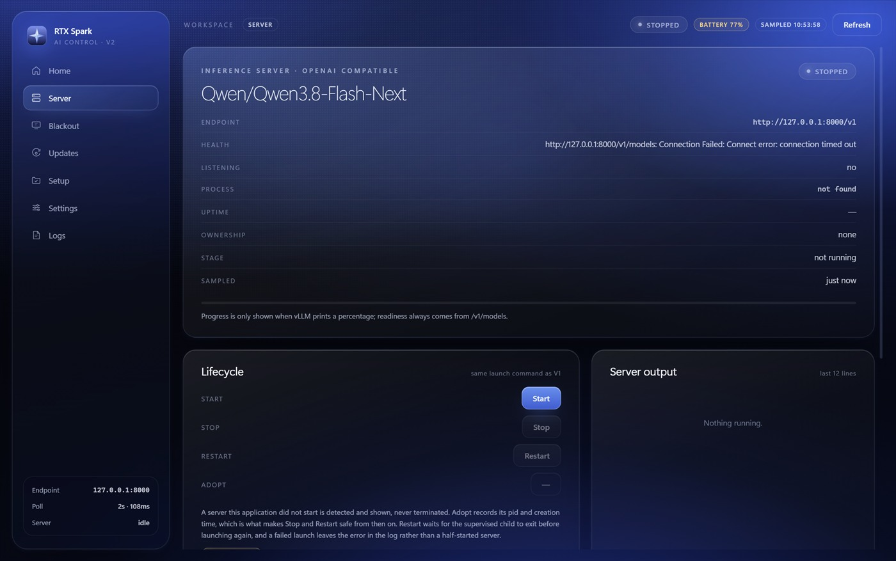
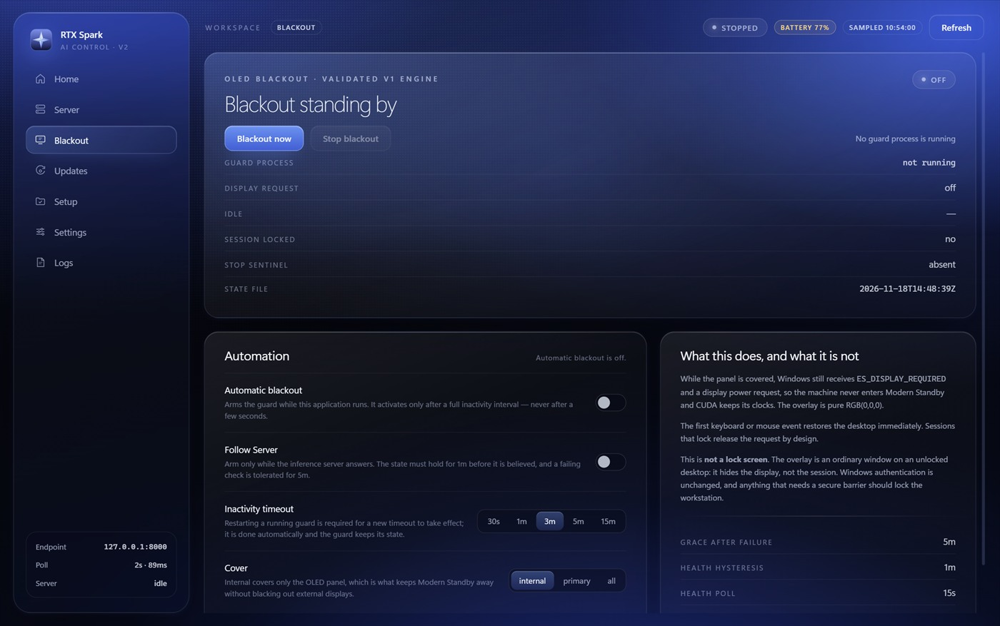
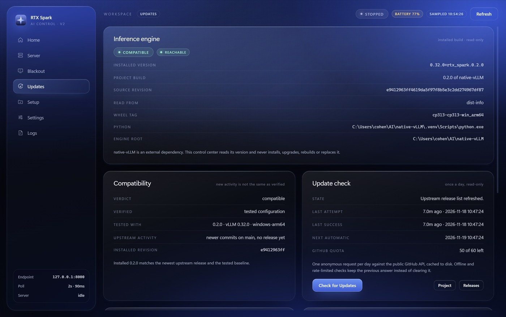
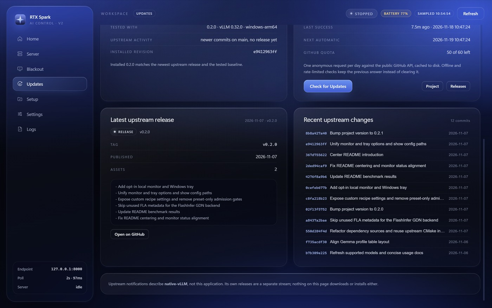
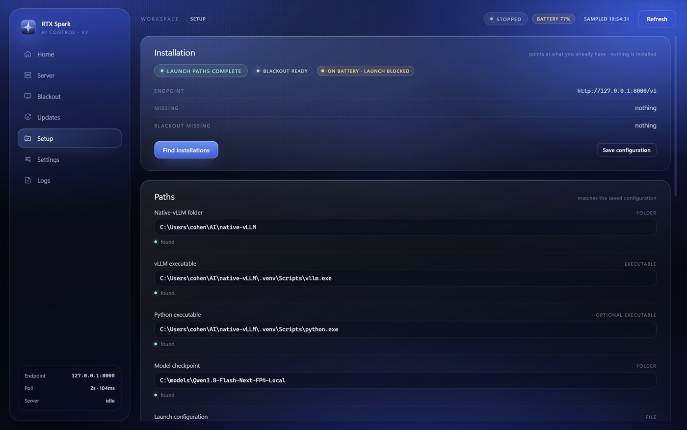
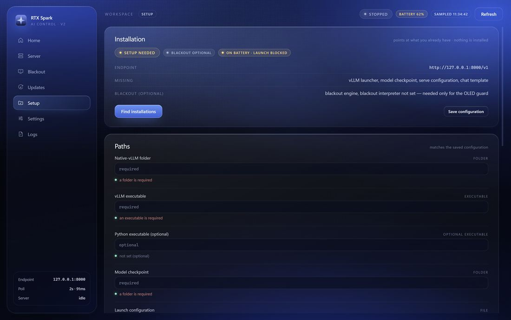
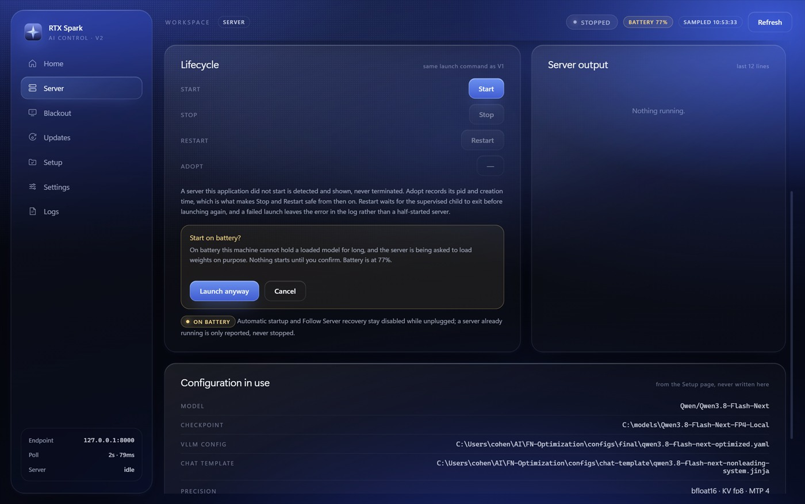

# RTX Spark AI Control

A native Windows ARM64 control center for a local **native-vLLM** inference server on an
NVIDIA RTX Spark laptop, with an OLED sleep guard that keeps the panel out of a
powered-on black state when the machine is idle.

Version **0.1.0** is an early public beta, and its release candidate is finalized
and awaiting publication: no tag, GitHub release or installer upload exists until
the maintainer approves them. A per-user Windows ARM64 installer has been built
and verified on this machine; see [release/v0.1.0/RELEASE-MANIFEST.md](release/v0.1.0/RELEASE-MANIFEST.md). The window is a Tauri 2 shell around a Rust backend and a
React frontend; it starts, stops, restarts and supervises vLLM locally, watches GPU
telemetry, and arms the blackout engine automatically after 180 seconds of
inactivity.

## Status: v0.1.0, early public beta

Version 0.1.0 is an **early public beta** from one developer, validated on one
machine. Read this table before installing anything; every row is a limit, not a
formality.

| | |
| --- | --- |
| Version | 0.1.0 — early public beta. No stability promise: the interface, the settings schema and the behaviour may change between versions, and there is no migration path yet |
| Supported platform | **Windows 11 ARM64** only. The package is ARM64 and refuses to install on x64. Other ARM64 Windows devices are untested |
| Tested hardware | **NVIDIA RTX Spark N1X** laptop — the only hardware family this has run on. GPU telemetry, battery gating and display control are unverified on any other device |
| Native vLLM | An **external dependency**. It is not bundled, not modified and not redistributed here; you install [`devjeonghwan/vllm-for-rtx-spark`](https://github.com/devjeonghwan/vllm-for-rtx-spark) yourself |
| Blackout engine | **External and optional.** No Python runtime and no guard script ship with this. Setup completes without them and the rest of the application is unaffected |
| Installer signature | **Unsigned.** There is no code-signing certificate, so there is no publisher identity to verify beyond the published SHA-256 |
| SmartScreen | **Expect a warning.** On first run of the installer Windows may show "Windows protected your PC" or an unknown-publisher prompt. Choose "More info" → "Run anyway" only if you accept an unsigned binary, or build from source instead |
| Test coverage | **One host, not several.** Everything here was measured on a single laptop. Nothing has been run on a second machine or by an independent tester, so no compatibility claim is made anywhere in this repository |

The inference engine's own project is credited in [§12](#12-credits-and-licence).

## Install with AI Agent

Prefer to let a coding agent do the reading? [AGENT-INSTALL.md](AGENT-INSTALL.md)
holds one self-contained prompt for Claude Code, Codex, OpenCode, T3 Code or any
other agent that can run read-only commands on your machine. Copy the block
between `PROMPT START` and `PROMPT END` into the agent and answer its two
questions.

| Path | What the agent does |
| --- | --- |
| **GUI only** | Detects Windows 11 ARM64, finds the official release at <https://github.com/cohenskocny/rtx-spark-ai-control/releases>, verifies the installer's SHA-256, asks for approval, installs the GUI, connects the native-vLLM installation you already have, and verifies the result **without loading a model** |
| **Guided full setup** | Adds hardware, driver and storage checks and walks through installing native vLLM from [`devjeonghwan/vllm-for-rtx-spark`](https://github.com/devjeonghwan/vllm-for-rtx-spark) — with a separate approval before any dependency install, model download or CUDA-related change |

The prompt requires approval before every action that changes the machine, and it
may not assume your model, checkpoint, launch configuration or folder layout: it
asks. If you decline a step, it stops and reports instead of re-asking.

None of it is privileged or hidden. The same ground is covered by two read-only
scripts that install, download and start nothing:

```powershell
powershell -File tools\check-requirements.ps1    # can this machine run it?
powershell -File tools\verify-install.ps1        # is what is installed correct?
```

Manual installation stays available: see [§4](#4-install-and-configure) below and
[INSTALL.md](INSTALL.md).



---

## Contents

1. [What it does](#1-what-it-does)
2. [What it does not do](#2-what-it-does-not-do)
3. [Requirements](#3-requirements)
4. [Install and configure](#4-install-and-configure)
5. [The pages](#5-the-pages)
6. [Battery behaviour](#6-battery-behaviour)
7. [Upstream vLLM notifications](#7-upstream-vllm-notifications)
8. [Security model](#8-security-model)
9. [Measured results](#9-measured-results)
10. [Development](#10-development)
11. [Documentation](#11-documentation)
12. [Credits and licence](#12-credits-and-licence)

---

## 1. What it does

| Area | Capability |
| --- | --- |
| Lifecycle | Start, stop and restart the local vLLM server; adopt a server it did not start; detect an already-running server without touching it |
| Supervision | Tail of the server's own output, readiness from `/v1/models` rather than a timer, weight-loading percentage only when vLLM prints one |
| Telemetry | GPU utilisation, VRAM, temperature, power, clocks and throttle reasons from `nvidia-smi`, sampled on a configurable interval |
| Blackout | "Blackout Now" and "Stop Blackout" start and stop the validated `blackout.py` OLED guard; automatic blackout arms after 180 s idle. **Optional**: without a guard script the page says so and the rest of the application is unaffected |
| Follow Server | Automation only arms while the server is genuinely healthy, with hysteresis and a failure grace period |
| Updates | Read-only check of the upstream native-vLLM project: installed build, newest release, recent commits, compatibility verdict |
| Setup | Every installation location is configurable, discoverable and validated; nothing is hard-coded to one machine |
| Diagnostics | Event ring, the server's own output tail, per-layer diagnostics, single-instance protection |

The interface is a cobalt "liquid glass" surface with static paint only: no ambient
animation loop runs, so an idle window costs almost nothing (see
[measured results](#9-measured-results)).

## 2. What it does not do

This is the point of the project, so it is stated plainly:

- **native-vLLM is an external dependency.** The application never downloads, installs,
  upgrades, rebuilds or replaces it. The Updates page is informational; there is no
  download button and no silent upgrade path.
- **It never installs or modifies model weights, GPU drivers, ASUS settings or the OLED
  power configuration.** Selecting a path in Setup records the path; it does not write
  to it.
- **It never launches inference on battery.** Automatic startup, Follow Server recovery
  and saved settings are all gated by the power source; a manual start needs an explicit
  confirmation in the window.
- **It is not a service or a daemon.** No autostart entry, no scheduled task, no
  registry writes, no background process after the window closes.

## 3. Requirements

**Tested configuration** (all numbers in this repository come from this machine):

| Component | Version |
| --- | --- |
| OS | Windows 11, ARM64 (Snapdragon-class SoC with an NVIDIA RTX Spark GPU) |
| Runtime | Microsoft Edge WebView2, installed with Windows 11. Not bundled |
| Inference engine | native-vLLM `0.32.0+rtx_spark.0.2.0` (upstream commit `e9412963ff`) |
| Model | `Qwen/Qwen3.8-Flash-Next`, FP4 checkpoint, MTP 4, FP8 KV cache |
| Build toolchain | Rust 1.98 `aarch64-pc-windows-msvc`, Node 26.13, npm 11.20 |

**Unverified, expect to work with the documented path overrides:** Windows 11 x64,
other Blackwell-generation laptop GPUs, other vLLM builds of the same project, other
checkpoints served by the OpenAI-compatible API. Nothing on this list has been run, so
nothing on this list is claimed. See [INSTALL.md](INSTALL.md).

## 4. Install and configure

- **Build from source**: [INSTALL.md](INSTALL.md#2-build-from-source). This is the
  only verified path today.
- **Per-user installer**: built and verified locally (NSIS, no administrator
  rights, ARM64 only) — [release/v0.1.0/RELEASE-MANIFEST.md](release/v0.1.0/RELEASE-MANIFEST.md).
  It is unsigned, so expect a SmartScreen warning on first run
  ([status](#status-v010-early-public-beta)).
- Connecting an existing vLLM installation: [INSTALL.md](INSTALL.md#3-connect-an-existing-native-vllm-installation).
- Every path, the endpoint and the served model name: [CONFIGURATION.md](CONFIGURATION.md).

On first launch the application opens with an incomplete configuration and says so. The
Setup page lists each location it needs, offers anything it found on the machine, and
refuses to save a half-valid set. Nothing is guessed from one person's directory layout.

## 5. The pages

| Page | What it is for |
| --- | --- |
| **Home** | One screen of truth: server state, the model in use, GPU KPIs, recent events |
| **Server** | Lifecycle controls, ownership, output tail, the configuration in use |
| **Blackout** | Manual and automatic blackout, timeout, cover, Follow Server |
| **Updates** | Installed engine build and upstream activity, read-only |
| **Setup** | Portable installation configuration and discovery |
| **Settings** | Interface and automation preferences, session facts |
| **Logs** | Event ring, the server's own output tail, diagnostics |





### Updates



The top half reads the installed build from the environment itself: version, project
build, source revision, wheel tag, interpreter and the file the version came from. The
bottom half reports the newest upstream release with its notes (scroll further for the
recent commit list).

Compatibility is a separate question from activity, and the page keeps them apart. "Newer
upstream" means GitHub has something this build does not. "Compatible" means the newest
release is the baseline this application was tested against
(`native-vLLM 0.2.0` · `vLLM 0.32.0` · `windows-arm64`). Anything else reports "unknown"
rather than a guess.



### Setup





Blackout is optional. A configuration with the two blackout paths empty saves and runs;
the guard's controls say why they are unavailable instead of refusing the whole setup.

Each location is validated as it is typed, and a field's verdict is shown next to it.
"Find installations" searches the locations the engine and the blackout guard normally
live in and offers what it found — clicking a suggestion fills the field; it changes
nothing until "Save configuration" succeeds. A V1 `config.json` can be imported; only its
documented keys are read and the file is never written.

### Battery



## 6. Battery behaviour

The window reads the power source with the documented Windows API on every sample and
shows it in the top bar.

| Power source | Automatic launch (saved setting, Follow Server, recovery) | Manual Start / Restart |
| --- | --- | --- |
| On AC | Allowed | Allowed |
| On battery | **Refused, with the reason shown** | Allowed only after an inline confirmation |

A server that is already running is reported, never stopped or restarted because of the
power state. The gate lives in the backend, not in the interface, so it applies to every
startup path rather than to the buttons that happen to be on screen.

## 7. Upstream vLLM notifications

The Updates page asks the public GitHub API about
[`devjeonghwan/vllm-for-rtx-spark`](https://github.com/devjeonghwan/vllm-for-rtx-spark):

- one anonymous request per day, plus whatever "Check for Updates" does;
- the answer is cached on disk, and a failed check keeps the previous answer instead of
  clearing it;
- offline, timeouts and rate limits are reported as their own states, with the remaining
  quota shown when GitHub provides it;
- ETags are used, so an unchanged answer costs a 304 rather than the full payload.

These notifications describe **native-vLLM**, not this application. Its own releases are a
separate stream, and nothing on that page installs anything.

## 8. Security model

The blackout guard paints the OLED panel black and holds a display power request so
the machine does not drop into Modern Standby. It does **not** hook, block or log
input: any real input removes the overlay immediately. It is a **curtain over an
unlocked desktop, not a lock** — that distinction is the whole security model, and
it is deliberate:

- The guard is started by this window, not installed as a service or a scheduled task.
- Closing the window stops the guard it started and leaves the inference server exactly as
  it was.
- A locked Windows session stands the guard down (the overlay and the display request are
  released and re-taken on unlock), because hiding an unlocked desktop is a comfort
  question and keeping a locked one lit is not this program's business. Use `Win+L` when
  you need a real boundary.
- Automatic blackout only arms while the server is verifiably healthy, so the screen does
  not go dark on top of a wedged server.

Report vulnerabilities as described in [SECURITY.md](SECURITY.md).

## 9. Measured results

**Phase 2 / 3 environment**: Windows ARM64, RTX Spark N1X, 128 GB unified memory, NVIDIA
driver 621.14, 96 GB GPU allocation, vLLM serving `Qwen/Qwen3.8-Flash-Next` (MTP 4, FP8 KV
cache, prefix caching, 409 600 context). CPU is reported as percent of one core, the unit
V1's 64 % baseline used.

| Condition | CPU (mean) | Median | RSS | Notes |
| --- | --- | --- | --- | --- |
| V1 (previous controller) | **64 %** | — | — | Tk repaint loop |
| V2 idle, before fixes | 85.2 % | 85.6 % | 470 MiB | infinite `breathe` animation + blur on every card |
| V2 idle, animations off | 12.97 % | 12.05 % | 471 MiB | isolates the animation cost |
| V2 idle, animations + blur off | 7.86 % | 6.40 % | — | isolates the blur cost |
| **V2 shipped, 1500×950** | **7.84 %** | 7.00 % | 451 MiB | 8.2× below V1 |
| V2 idle, minimised | 0.47 % | 0.00 % | — | polling suspended, 7 processes alive |
| V2 idle, 2400×1400 logical | 11.38 % | 12.25 % | — | 2.56× the painted area |
| **V2 Phase 2, full control center** | **5.88 / 5.37 %** | 4.20 % | 451–460 MiB | supervisor + events, no regression |
| V2 Phase 3 release build, window occluded | 0.39 % | — | 475 MiB | seven pages, polling suspended as designed |
| V2 Phase 3 release build, first 12 s after launch | 10.68 % | — | 471 MiB | webview startup and the first update check, not idle |

| Metric | Value |
| --- | --- |
| Release binary (`app:build`, no bundle) | 4.9 MB |
| Frontend bundle | 204.5 kB JS (62.7 kB gzip), 21.3 kB CSS |
| API round trip at idle | 18 ms mean; 3–4 ms on the health probe |
| Idle GPU utilisation / power | 0.05–0.16 % / 1.55 W (Phase 2); 2 % / 1.46 W sampled during the Phase 3 run |
| Processes in tree | 7 |
| Mock start → ready | 2.52 s; restart → ready 3.02 s |
| Development startup | Vite ready in ~0.43 s, `cargo` dev build ~10 s |

**Not measured in Phase 3:** the visible, foreground idle figure for the two new pages.
The window could not be brought to the foreground from this session's shell, so every
Phase 3 sample is either startup-inclusive or occluded (polling suspended). The new pages
add no animation and no polling of their own — the Updates page renders from the snapshot
that already exists — but "no regression" for them is an argument, not a measurement.

**The idle-cost defect and its fix.** Two causes, each confirmed by probe: an infinite CSS
`breathe` animation forced the compositor to run at 60 Hz forever (disabling animation
alone: 85.2 % → 12.97 %), and `backdrop-filter: blur(26px)` on every card re-blurred each
surface per paint (removing it from cards, keeping it on the rail: → 7.84 %). The pulse was
replaced with a static halo.

**Inference contention.** BF16 8192³ GEMM, GUI closed vs visible, interleaved: 83.24 TFLOPS
visible vs 82.23 closed — inside the machine's own ±5 TFLOPS spread. Generation through the
real server: 36.8–43.6 tok/s, a spread larger than any difference between the two
conditions.

## 10. Development

```powershell
git clone https://github.com/cohenskocny/rtx-spark-ai-control.git
cd rtx-spark-ai-control
npm install
npm run app:dev     # development window: Vite + cargo, hot reload
npm run build       # typecheck the frontend and bundle it
npm run test:web    # frontend unit tests (node --test, no extra dependency)
cargo test --manifest-path src-tauri\Cargo.toml
npm run tauri build # release binary + per-user NSIS installer (verified, exit 0)
node tools/check-config-example.mjs   # the example configuration is still a template
```

`.github/workflows/ci.yml` runs the same checks on GitHub's `windows-11-arm`
runner with the pinned versions recorded in the release manifest. It passes on
this tree: two `master` runs succeeded — `8f78f7c` in 3 m 41 s and `c861aa2` in
3 m 34 s. See the Actions tab and [HANDOFF.md](HANDOFF.md).

`npm run app:dev` used to die with an `EBUSY` error from the file watcher: Vite walked
`src-tauri/target` while cargo executed a build script inside it, and the watcher's
unhandled error took the dev server down. `vite.config.ts` now excludes that tree
explicitly. The development window and the release build are verified separately — see
[TEST-RESULTS.md](TEST-RESULTS.md).

Contributions: [CONTRIBUTING.md](CONTRIBUTING.md).

## 11. Documentation

| File | Contents |
| --- | --- |
| [AGENT-INSTALL.md](AGENT-INSTALL.md) | A paste-in prompt for a coding agent: GUI-only and guided full setup |
| [AGENTS.md](AGENTS.md) | Repository guide for coding agents: architecture, commands, boundaries, safety |
| [INSTALL.md](INSTALL.md) | Source build, connecting an existing installation, first run, uninstall |
| [CONFIGURATION.md](CONFIGURATION.md) | Every setting, every path, discovery rules |
| [TROUBLESHOOTING.md](TROUBLESHOOTING.md) | Symptoms, causes and fixes, including the Modern Standby trap |
| [SECURITY.md](SECURITY.md) | Threat model, the unlocked-session trade-off, reporting |
| [CONTRIBUTING.md](CONTRIBUTING.md) | Build, test, style, commit rules |
| [CHANGELOG.md](CHANGELOG.md) | Release history — 0.1.0 is the first release |
| [THIRD-PARTY-NOTICES.md](THIRD-PARTY-NOTICES.md) | Dependencies and their licences |
| [LICENSE](LICENSE) | MIT, for this application's own code |
| [TEST-RESULTS.md](TEST-RESULTS.md) | Item-by-item evidence for the claims above |
| [PUBLICATION-AUDIT.md](PUBLICATION-AUDIT.md) | Pre-publication audit: what is verified, what is not, and the blockers |
| [HANDOFF.md](HANDOFF.md) | Current state of the work, for whoever picks it up |

## 12. Credits and licence

- **native-vLLM**: [`devjeonghwan/vllm-for-rtx-spark`](https://github.com/devjeonghwan/vllm-for-rtx-spark)
  (Apache-2.0, per the repository's own licence metadata) is the inference engine
  this application manages. It is an external dependency: not bundled, not modified,
  not redistributed here.
- **vLLM**: [`vllm-project/vllm`](https://github.com/vllm-project/vllm) (Apache-2.0),
  upstream of the above.
- **Tauri**, **React**, **WebView2**: see [THIRD-PARTY-NOTICES.md](THIRD-PARTY-NOTICES.md)
  for the actual dependency licences.
- Interface: original work in a cobalt/pale-blue visual language; no third-party marks,
  wording or layout are copied. The icon is drawn in this repository by
  `tools/make-icon.py`, and no fonts are bundled.

This application's own code, styles and generated assets are licensed under the
[MIT License](LICENSE). The dependencies and the external engine keep their own
licences — MIT on this side grants nothing about them.
